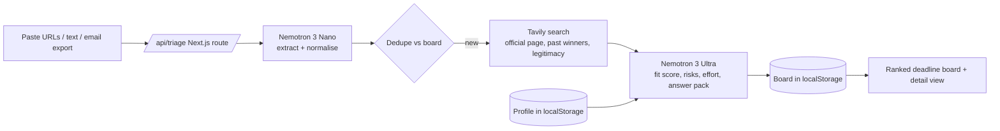

[](./LICENSE)

# Opportunity Graph

A personal AI that triages the fellowships, grants and hackathons that arrive every day, and tells you which ones are worth your time.

## The problem

Builders across Africa get a steady stream of opportunities: fellowships, grants, hackathons, accelerators. Most arrive as forwarded emails and links. Reading each one, checking eligibility (many quietly exclude African residents or individuals), checking it is legitimate, and drafting an application takes hours. Good ones get missed; bad fits waste time.

Opportunity Graph takes the pile, extracts the facts, researches each item, scores fit against your own profile with written reasons and eligibility risks, and drafts a first answer pack. You stay in control: nothing is submitted for you, and the model is told never to invent achievements or numbers.

## Architecture



Without keys, the same pipeline runs in a labelled demo mode with rule-based stand-ins.

## Where Nemotron and Nebius Token Factory are used

All calls go through the OpenAI-compatible Token Factory API at `https://api.tokenfactory.nebius.com/v1` (`src/lib/nebius.ts`).

| Step | Model | File |
| --- | --- | --- |
| Extraction and normalisation of each pasted item | `nvidia/NVIDIA-Nemotron-3-Nano-30B-A3B` | `src/lib/pipeline.ts` (step 1, `EXTRACT_SYS`) |
| Fit reasoning, score, risks, answer pack | `nvidia/Nemotron-3-Ultra-550b-a55b` | `src/lib/pipeline.ts` (step 3, `ASSESS_SYS`) |
| Fallback if Ultra is unavailable | `nvidia/nemotron-3-super-120b-a12b` | `src/lib/nebius.ts` (`chatJson`) |

Model IDs come from the Token Factory model catalog and can be overridden with env vars.

## Where Tavily is used

`src/lib/tavily.ts`:
- `extractUrl` pulls page content when you paste a bare URL.
- `research` runs three searches per opportunity (official page and deadline, past winners, legitimacy signals) and returns deduped sources, which are passed to Nemotron Ultra and shown in the detail view.

## Setup

```bash
git clone https://github.com/eddiemessiah/opportunity-graph
cd opportunity-graph
npm install
cp .env.example .env.local   # add your keys, or leave empty for demo mode
npm run dev
```

Open http://localhost:3000, click "Load labelled examples" or paste your own items. Edit your profile at `/profile`.

## Environment variables

| Name | Required | Purpose |
| --- | --- | --- |
| `NEBIUS_API_KEY` | for live mode | Nebius Token Factory key (server-side only) |
| `TAVILY_API_KEY` | for research | Tavily key (server-side only) |
| `NEBIUS_BASE_URL` | no | Defaults to `https://api.tokenfactory.nebius.com/v1` |
| `NEMOTRON_FAST_MODEL` | no | Defaults to `nvidia/NVIDIA-Nemotron-3-Nano-30B-A3B` |
| `NEMOTRON_REASON_MODEL` | no | Defaults to `nvidia/Nemotron-3-Ultra-550b-a55b` |

Keys are only read in API routes and never sent to the browser.

## Built during the submission period

All code in this repository was written from scratch on 29–30 October 2026 for the Nebius x NVIDIA Global AI Hackathon. The idea of an open-source opportunity graph was planned earlier; no earlier code was reused.

## Feedback on Nebius Token Factory and Tavily

_To be filled in by the author after using both in live mode._

- Nebius Token Factory: [what worked, what was hard, latency, model choice, docs]
- Nemotron Nano vs Ultra: [observations]
- Tavily: [result quality, extract vs search, docs]
